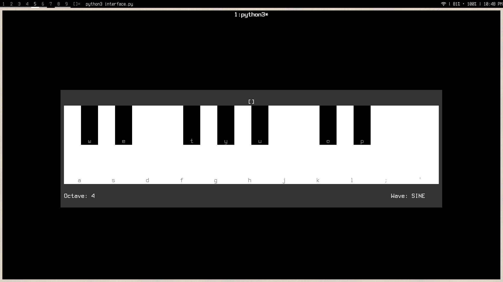
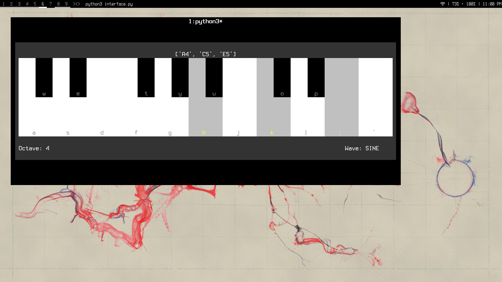

**Orca Synth**

Orca synth or pysynth, is a synthesizer playback library and textual terminal interface.

Features
--------

* Python Textual Terminal User Interface
* Sine, Square, Sawtooth waves
* 88 Keys, 6 Octaves 
* C Playback API
 
Screenshots
-----------
***Textual Interface***:
<br>

<br>
***Note Dashboard***:
<br>


Dependencies
------------

Orca synth interface requires the following to be installed to be run. 

```
   * textual
   * pynput
   * ctypes
```
Building
--------

libplayback.so can be built with c standard libraries and the miniaudio header file.
 

&copy; theGrumpyGrouch 2026
